# CCMS G.R.A.C.E. PORTAL — Entity Relationship Diagram (ERD)
**Gateway for Responsive Academic Community Extension**  
*College of Computing and Multimedia Studies (CCMS) — University of Camarines Norte*  
*IT 116: System Analysis and Design | Database Architecture Specification (3NF Aligned)*

---

## 1. High-Level Architecture & ERD Overview

The **CCMS G.R.A.C.E. PORTAL** database is structured around a centralized **`PROJECT`** hub in **Third Normal Form (3NF)**. It cleanly segregates master entities, transactional entities, multi-stage approval logs, and M:N associative junction tables to support the full institutional lifecycle of extension services:

1. **User Identity & Access Governance**: `ROLE`, `PERSON`, `USER_ACCOUNT`
2. **Project & Lifecycle Management**: `PROJECT`, `PROPOSAL`
3. **Institutional Stakeholders**: `BENEFICIARY`, `PROJECT_BENEFICIARY`, `PARTNER`, `PROJECT_PARTNER`
4. **Operations & Human Capital**: `PROJECT_TEAM`, `ACTIVITY`, `ACTIVITY_PARTICIPANT`
5. **Faculty Extension Engagement**: `FACULTY_REQUEST` (Resource Speakers, Trainers, Coaches, Focal Persons)
6. **Financial Resource Management**: `FUNDING_SOURCE`, `PROJECT_FUNDING`
7. **Multi-Stage Institutional Governance**: `APPROVAL` (8 Institutional Stages)
8. **Compliance, Documents & Reporting**: `DOCUMENT`, `REPORT`, `REPORT_DOCUMENT`
9. **Project Closeout & Quality Assurance**: `COMPLETION`, `SATISFACTION_EVALUATION`

---

## 2. Complete Entity Relationship Diagram (Crow's Foot Notation)

```mermaid
erDiagram
    %% ==========================================
    %% 1. USER & IDENTITY SUBSYSTEM
    %% ==========================================
    ROLE ||--o{ USER_ACCOUNT : "assigned_to"
    PERSON ||--o| USER_ACCOUNT : "has_account"
    PERSON ||--o{ PROJECT : "creates"
    PERSON ||--o{ PROJECT_TEAM : "serves_in"
    PERSON ||--o{ DOCUMENT : "uploads"
    PERSON ||--o{ REPORT : "submits"
    PERSON ||--o{ FACULTY_REQUEST : "assigned_as_faculty"
    PERSON ||--o{ FACULTY_REQUEST : "filed_by_proponent"

    %% ==========================================
    %% 2. PROJECT & PROPOSAL SUBSYSTEM
    %% ==========================================
    PROJECT ||--o{ PROPOSAL : "has_versions"
    PROJECT ||--o{ PROJECT_BENEFICIARY : "caters_to"
    BENEFICIARY ||--o{ PROJECT_BENEFICIARY : "benefits_from"
    PROJECT ||--o{ PROJECT_PARTNER : "collaborates_with"
    PARTNER ||--o{ PROJECT_PARTNER : "partnered_in"
    PROJECT ||--o{ PROJECT_TEAM : "staffed_by"

    %% ==========================================
    %% 3. OPERATIONS & ACTIVITIES
    %% ==========================================
    PROJECT ||--o{ ACTIVITY : "schedules"
    ACTIVITY ||--o{ ACTIVITY_PARTICIPANT : "records_attendance"
    PROJECT ||--o{ FACULTY_REQUEST : "engages_faculty_for"
    ACTIVITY ||--o{ FACULTY_REQUEST : "associates_event"

    %% ==========================================
    %% 4. FUNDING & GOVERNANCE
    %% ==========================================
    PROJECT ||--o{ PROJECT_FUNDING : "receives_budget"
    FUNDING_SOURCE ||--o{ PROJECT_FUNDING : "provides_allocation"
    PROJECT ||--o{ APPROVAL : "undergoes_review"

    %% ==========================================
    %% 5. COMPLIANCE, REPORTING & CLOSEOUT
    %% ==========================================
    PROJECT ||--o{ DOCUMENT : "stores_attachments"
    PROJECT ||--o{ REPORT : "submits_reports"
    REPORT ||--o{ REPORT_DOCUMENT : "contains_evidence"
    DOCUMENT ||--o{ REPORT_DOCUMENT : "referenced_in"
    PROJECT ||--o| COMPLETION : "finalized_by"
    PROJECT ||--o{ SATISFACTION_EVALUATION : "evaluated_by"

    %% ==========================================
    %% ENTITY ATTRIBUTE DEFINITIONS
    %% ==========================================

    ROLE {
        string role_id PK "e.g. R002, R003, R004"
        string role_name "coordinator | proponent | dean"
        string description "Operational scope & permissions"
        boolean is_active "Active role indicator"
    }

    PERSON {
        string person_id PK "e.g. PER001, PER002"
        string first_name "Given name"
        string last_name "Surname"
        string email "Institutional email (@ucn.edu.ph)"
        string contact_no "Mobile contact number"
        string affiliation "Academic Department / College"
        string designation "Academic rank / Faculty specialization"
    }

    USER_ACCOUNT {
        string user_id PK "e.g. U001, U002"
        string person_id FK "References PERSON"
        string role_id FK "References ROLE"
        string username "Portal login identifier"
        string password_hash "Encrypted security credential"
        string account_status "active | suspended"
        datetime created_at "Account registration timestamp"
    }

    PROJECT {
        string project_id PK "e.g. EXT-2026-001"
        string project_code "Official tracking code (CCMS-EXT-001)"
        string title "Official title of the extension project"
        string description "Executive project overview"
        string service_type "Skills Training | Consultancy | System Dev"
        string source_type "External Request | Faculty-Initiated"
        date start_date "Target commencement date"
        date end_date "Target completion date"
        string project_status "Submitted | Under Review | Ongoing | Completed"
        boolean ntp_issued "Notice to Proceed status"
        date ntp_date "NTP issuance date"
        string ntp_reference "NTP reference tracking number"
        boolean moa_signed "MOA execution indicator"
        string moa_reference "Signed MOA legal reference number"
        string created_by FK "References PERSON(person_id)"
    }

    PROPOSAL {
        string proposal_id PK "e.g. PROP-001"
        string project_id FK "References PROJECT"
        int version_no "Version iteration (1, 2, ...)"
        date submission_date "Filing date"
        string evaluation_status "Compliant | For Revision | Non-Compliant"
        string approval_status "Endorsed | Pending Dean | Approved"
        string remarks "Coordinator evaluation comments"
    }

    BENEFICIARY {
        string beneficiary_id PK "e.g. BEN-001"
        string beneficiary_name "Target community / LGU / organization"
        string beneficiary_type "Barangay | School | Farmers | MSME"
        string address "Geographic municipality / barangay"
        string contact_person "Community liaison / representative"
        string contact_no "Contact number"
    }

    PROJECT_BENEFICIARY {
        string project_id PK,FK "References PROJECT"
        string beneficiary_id PK,FK "References BENEFICIARY"
        string participation_role "Target Recipient | Co-implementer"
        string remarks "Specific impact cohort notes"
    }

    PARTNER {
        string partner_id PK "e.g. PRT-001"
        string organization_name "Partner entity / host agency"
        string organization_type "LGU | DepEd | NGO | Industry Partner"
        string address "Office headquarters location"
        string contact_person "Official authorized signatory"
        string contact_no "Official contact details"
    }

    PROJECT_PARTNER {
        string project_id PK,FK "References PROJECT"
        string partner_id PK,FK "References PARTNER"
        string partnership_role "Funding Partner | Co-Host | Venue Provider"
        string remarks "MOU/MOA stipulations"
    }

    PROJECT_TEAM {
        string project_team_id PK "e.g. TM-001"
        string project_id FK "References PROJECT"
        string person_id FK "References PERSON"
        string team_role "Project Leader | Co-Leader | Technical Staff"
        string participation_status "Active | Concluded"
        date date_joined "Assignment effective date"
        date date_ended "Assignment conclusion date"
    }

    ACTIVITY {
        string activity_id PK "e.g. ACT-001"
        string project_id FK "References PROJECT"
        string activity_name "Module / Seminar / Workshop Title"
        string activity_type "Lecture | Laboratory | Consultation"
        string description "Activity scope & target deliverables"
        date schedule_start "Commencement date/time"
        date schedule_end "Conclusion date/time"
        string venue "Physical venue or online platform"
        string activity_status "Scheduled | Ongoing | Completed | Postponed"
    }

    ACTIVITY_PARTICIPANT {
        string activity_participant_id PK "e.g. AP-001"
        string activity_id FK "References ACTIVITY"
        string participant_name "Attendee full name"
        string participant_role "Participant | Beneficiary Trainee"
        string affiliation "Barangay / Organization represented"
        string attendance_status "Present | Excused | Absent"
    }

    FACULTY_REQUEST {
        string request_id PK "e.g. FREQ-2026-001"
        string request_code "CCMS-FREQ-2026-001"
        string project_id FK "References PROJECT"
        string activity_id FK "References ACTIVITY"
        string faculty_id FK "References PERSON (Target Faculty)"
        string proponent_id FK "References PERSON (Project Proponent)"
        string requested_role "Resource Speaker | Trainer | Focal Person"
        date event_date "Date of extension engagement"
        string event_time "Time and duration"
        string venue "Event location"
        string modality "Face-to-Face | Online | Hybrid"
        string status "Pending Coord | Pending Dean | Approved | Revision"
        string current_stage "Coordinator Review | Dean Endorsement"
    }

    FUNDING_SOURCE {
        string funding_source_id PK "e.g. FS-001"
        string source_name "GAA | LGU Counterpart | Partner Grant"
        string source_type "Internal University | External Agency"
        string description "Granting terms & conditions"
        boolean is_active "Active funding line"
    }

    PROJECT_FUNDING {
        string project_funding_id PK "e.g. PF-001"
        string project_id FK "References PROJECT"
        string funding_source_id FK "References FUNDING_SOURCE"
        decimal approved_amount "Budget allocated in PHP"
        string funding_status "Approved | Released | Liquidated"
        string remarks "Line-item budget reference"
    }

    APPROVAL {
        string approval_id PK "e.g. APP-001"
        string project_id FK "References PROJECT"
        string approval_stage "Stage 1: Completeness to Stage 8: NTP"
        string decision "Approved | Returned | Rejected | Endorsed"
        date decision_date "Timestamp of review action"
        string approved_by "Reviewing Officer (Coordinator / Dean / VP)"
        string signature_reference "Digital verification token"
        string remarks "Evaluator notes and feedback"
    }

    DOCUMENT {
        string document_id PK "e.g. DOC-001"
        string project_id FK "References PROJECT"
        string uploaded_by FK "References PERSON"
        string document_type "Proposal | MOA | LOI | Attendance | Photo"
        string file_name "Stored file name"
        string file_path "URL or secure storage path"
        string file_size "File size in KB / MB"
        string file_type "PDF | DOCX | PNG"
        int version_no "File revision counter"
        datetime uploaded_at "Upload timestamp"
    }

    REPORT {
        string report_id PK "e.g. REP-001"
        string project_id FK "References PROJECT"
        string submitted_by FK "References PERSON"
        string report_type "Quarterly Progress | Terminal Accomplishment"
        string form_reference "CNSC-OP-EXT-03A Equivalent"
        string reporting_period "e.g. Q3 2026 / Mid-term"
        date submitted_date "Official submission date"
        string report_status "Draft | Submitted | Verified | Cleared"
    }

    REPORT_DOCUMENT {
        string report_id PK,FK "References REPORT"
        string document_id PK,FK "References DOCUMENT"
    }

    COMPLETION {
        string completion_id PK "e.g. CMP-001"
        string project_id FK "References PROJECT (1:1)"
        date completion_date "Project termination / turnover date"
        string completion_status "Cleared & Archived | For Terminal Review"
        string accomplishment_summary "Key metrics, beneficiaries served"
    }

    SATISFACTION_EVALUATION {
        string satisfaction_id PK "e.g. SAT-001"
        string project_id FK "References PROJECT"
        string respondent_name "Client / Participant Name"
        string affiliation "Community entity represented"
        int relevance_rating "Likert Scale (1 - 5)"
        int quality_rating "Likert Scale (1 - 5)"
        int benefit_impact_rating "Likert Scale (1 - 5)"
        int overall_satisfaction "Likert Scale (1 - 5)"
        date response_date "Evaluation date"
    }
```

---

## 3. Subsystem Breakdown & Relationships

### A. User & Identity Management
| Relationship | Cardinality | Business Rule |
|---|---|---|
| `ROLE` ➔ `USER_ACCOUNT` | **1 : N** | A role defines permission levels (Coordinator, Proponent, Dean) granted to multiple user accounts. |
| `PERSON` ➔ `USER_ACCOUNT` | **1 : 1** | Each user account corresponds to an authenticated faculty member or administrative official in the personnel roster. |

### B. Core Project & Proposal Management
| Relationship | Cardinality | Business Rule |
|---|---|---|
| `PERSON` ➔ `PROJECT` | **1 : N** | A faculty member (Proponent) initiates one or more extension project proposals. |
| `PROJECT` ➔ `PROPOSAL` | **1 : N** | A project can have versioned proposal revisions (v1.0, v1.1) throughout the evaluation cycle. |
| `PROJECT` ➔ `APPROVAL` | **1 : N** | A project progresses through 8 formalized approval and endorsement gates (Completeness Check, Dean Endorsement, Eligibility, Compliance, Technical Evaluation, Institutional Endorsement, Board Approval, and NTP). |

### C. Stakeholders & External Partnerships
| Relationship | Cardinality | Business Rule |
|---|---|---|
| `PROJECT` ➔ `PROJECT_BENEFICIARY` ➔ `BENEFICIARY` | **M : N** | Projects serve multiple target communities (barangays, schools, coops), and beneficiaries may benefit from multiple extension projects. |
| `PROJECT` ➔ `PROJECT_PARTNER` ➔ `PARTNER` | **M : N** | Projects establish formal agreements (MOA/MOU) with multiple host LGUs or partner agencies. |

### D. Operations, Project Teams & Activities
| Relationship | Cardinality | Business Rule |
|---|---|---|
| `PROJECT` ➔ `PROJECT_TEAM` ➔ `PERSON` | **M : N** | Projects are staffed by interdisciplinary teams of faculty members with designated roles (Project Leader, Co-Leader, Facilitator). |
| `PROJECT` ➔ `ACTIVITY` | **1 : N** | Each project schedules multiple discrete activities (trainings, workshops, community scoping). |
| `ACTIVITY` ➔ `ACTIVITY_PARTICIPANT` | **1 : N** | Each activity maintains verified attendance lists and participant profiling. |

### E. Faculty Extension Service Requests
| Relationship | Cardinality | Business Rule |
|---|---|---|
| `PROJECT` ➔ `FACULTY_REQUEST` | **1 : N** | Proponents request specialized CCMS faculty members as Resource Speakers, Trainers, Coaches, or Focal Persons. |
| `ACTIVITY` ➔ `FACULTY_REQUEST` | **1 : N** | Requests are tied to timed training programs with required attachments (Letter of Intent, Invitation, and Program Matrix). |
| `PERSON` ➔ `FACULTY_REQUEST` | **1 : N** | Tracks both the requesting Proponent and the target Faculty Specialist, with multi-stage Coordinator completeness check and College Dean Special Order issuance. |

### F. Financial Management & Funding
| Relationship | Cardinality | Business Rule |
|---|---|---|
| `PROJECT` ➔ `PROJECT_FUNDING` ➔ `FUNDING_SOURCE` | **M : N** | Projects can combine multiple funding lines (University GAA, LGU counterpart, external grants). |

### G. Document Management, Reporting & Quality Assurance
| Relationship | Cardinality | Business Rule |
|---|---|---|
| `PROJECT` ➔ `DOCUMENT` | **1 : N** | Centralized document repository storing proposals, MOAs, activity photos, and compliance attachments. |
| `PROJECT` ➔ `REPORT` | **1 : N** | Proponents submit quarterly progress reports and terminal accomplishment reports. |
| `REPORT` ➔ `REPORT_DOCUMENT` ➔ `DOCUMENT` | **M : N** | Formal reports bundle specific verified supporting evidence and liquidation attachments. |
| `PROJECT` ➔ `COMPLETION` | **1 : 1** | When all activities and terminal reports are approved, a single project clearance record is certified. |
| `PROJECT` ➔ `SATISFACTION_EVALUATION` | **1 : N** | Beneficiary survey respondents provide Likert ratings (1–5) on relevance, timeliness, and community impact. |

---

## 4. Normalization Audit (Proof of 3NF)

1. **First Normal Form (1NF)**:
   - All attributes contain atomic, indivisible values.
   - Repeating groups (e.g., team members, beneficiaries, partners, documents) are decoupled into discrete child and junction tables (`PROJECT_TEAM`, `PROJECT_BENEFICIARY`, `PROJECT_PARTNER`, `ACTIVITY_PARTICIPANT`).

2. **Second Normal Form (2NF)**:
   - All tables have a clearly defined primary key (single attribute or composite primary key).
   - In all junction tables (`PROJECT_BENEFICIARY`, `PROJECT_PARTNER`, `REPORT_DOCUMENT`), non-key attributes are fully functionally dependent on the entire composite primary key.

3. **Third Normal Form (3NF)**:
   - There are zero transitive dependencies ($X \rightarrow Y \rightarrow Z$).
   - Person details (`first_name`, `email`, `affiliation`) reside strictly in `PERSON`, rather than being duplicated inside `PROJECT`, `PROJECT_TEAM`, or `USER_ACCOUNT`.
   - Partner details reside strictly in `PARTNER`, rather than embedded in `PROJECT`.
